<picture>
  <source media="(max-width: 600px) and (prefers-color-scheme: dark)" srcset="assets/01-hola-m-dark.svg">
  <source media="(max-width: 600px)" srcset="assets/01-hola-m-light.svg">
  <source media="(prefers-color-scheme: dark)" srcset="assets/01-hola-dark.svg">
  
</picture>

Hola, soy Juan Camilo.

Me gusta construir cosas enteras. No solo la parte que me toca, sino todo lo que hace falta para que algo funcione en manos de alguien: la app, la API, los datos y, cada vez más, la IA que lo vuelve útil. Ese recorrido completo, de la idea a la persona que lo usa, es lo que más disfruto.

Hoy dedico casi todo mi tiempo a **Sapienza Academia**, una plataforma educativa que cofundé para impulsar el mérito profesional y la preparación para concursos públicos en Colombia. Ahí aprendí que el código es la mitad del trabajo: la otra mitad es entender a quien estudia a las once de la noche después de trabajar y no hacerle perder ni un minuto.

Casi todo lo que hago vive en repositorios privados, así que aquí no vas a encontrar mucho código. Vas a encontrar cómo pienso y con qué trabajo.

<picture>
  <source media="(max-width: 600px) and (prefers-color-scheme: dark)" srcset="assets/02-sistemas-m-dark.svg">
  <source media="(max-width: 600px)" srcset="assets/02-sistemas-m-light.svg">
  <source media="(prefers-color-scheme: dark)" srcset="assets/02-sistemas-dark.svg">
  
</picture>

### Lo que suelo construir

**Backends en Go** que se despliegan sin drama. Separo el núcleo del negocio de la base de datos y de la interfaz, para poder cambiar una sin romper la otra. A veces basta con SQLite dentro del mismo binario; a veces hace falta PostgreSQL. La gracia está en saber cuál.

**Agentes de IA que corren en local**, con voz y visión. Lo que más me interesa no es el modelo, sino decidir cuándo no hace falta: si una regla resuelve algo en milisegundos, no tiene sentido pagar un LLM por eso.

**Producto educativo con contenido que se puede confiar.** Generar material con IA es fácil. Lo difícil es verificarlo antes de que llegue a alguien que va a estudiar con él, y ahí pongo la mayor parte del esfuerzo.

<picture>
  <source media="(max-width: 600px) and (prefers-color-scheme: dark)" srcset="assets/03-stack-m-dark.svg">
  <source media="(max-width: 600px)" srcset="assets/03-stack-m-light.svg">
  <source media="(prefers-color-scheme: dark)" srcset="assets/03-stack-dark.svg">
  
</picture>

### Cómo llegué aquí

En 2025 aprendía con ejercicios de bootcamp: HTML, Java, SQL, lo de siempre. En 2026 empecé a construir en serio. Primero con Spring Boot y React, después metiéndome de lleno en IA aplicada, y en los últimos meses con Go, apps móviles en Flutter y el ajuste de modelos pequeños. Las barras de arriba salen de mi propio código, no de una lista de deseos.

Todavía me falta mucho. Quiero publicar más en abierto y aprender a construir sistemas que aguanten mucha más gente de la que hoy tengo.

### Hablemos

Si tienes un producto por construir, una idea para hacer juntos o un equipo donde crees que encajo, escríbeme. Respondo.

[Correo](mailto:juancamiloguerrerocarrillo@gmail.com) · [LinkedIn](https://www.linkedin.com/in/juan-camilo-guerrero-carrillo-845881374) · [Portafolio](https://portfolio-juan-camilo-guerrero.netlify.app/)
